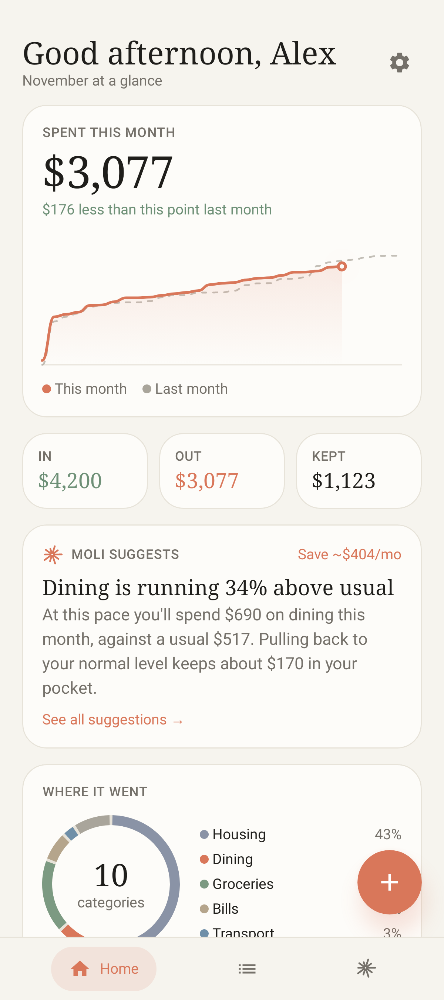
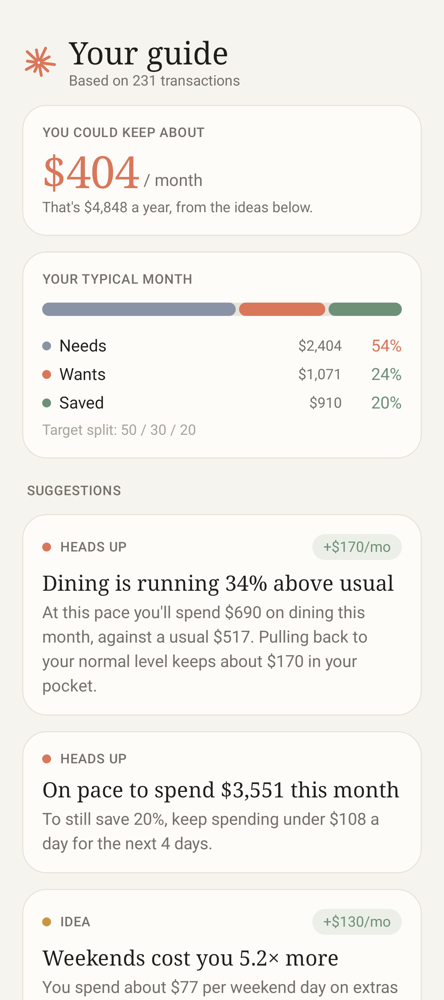
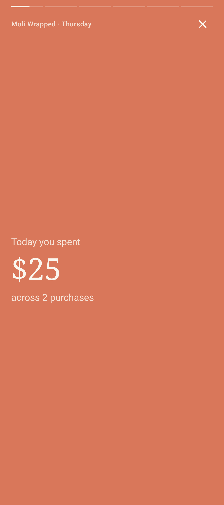
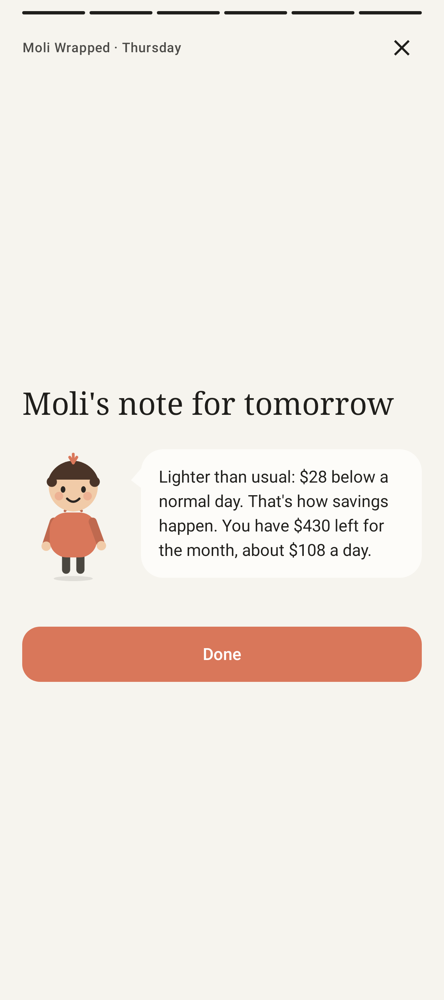
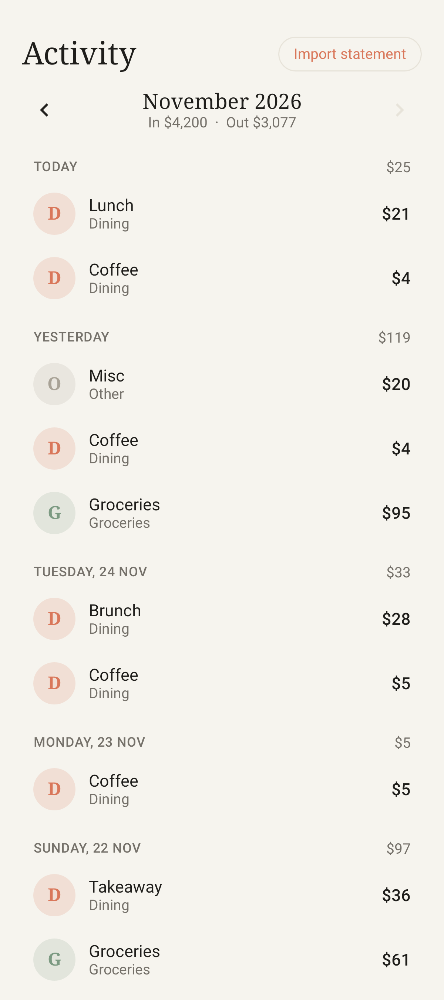
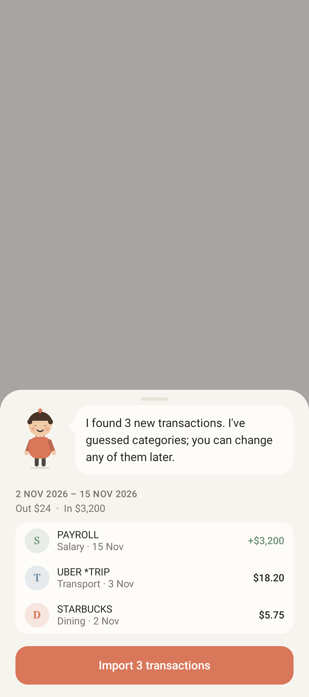
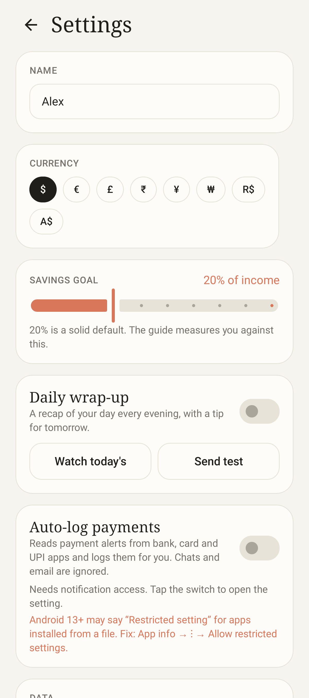

# Moli — a quiet finance guide (Android)

A minimalist, animated Android app that tracks what you earn and spend and tells you where you could save.

**Install:** download [`Moli.apk`](Moli.apk) on your phone, open it, and allow "install unknown apps" when asked.

[`Moli-autolog.apk`](Moli-autolog.apk) adds auto-logging from payment notifications. Play Protect blocks this one in some countries (e.g. India) because sideloaded apps that read notifications are restricted there; use `Moli.apk` if it won't install.

| Home | Guide | Wrapped | Moli's note |
|---|---|---|---|
|  |  |  |  |
| **Activity** | **Import** | **Settings** | **Welcome** |
|  |  |  |  |

## What it does
- **Log income & expenses** in a bottom sheet (tap +). Tap any transaction to edit or delete it.
- **Minimal charts:** cumulative spending line (this month vs last), category ring, 6‑month bars, needs/wants/saved split bar — all drawn by hand and animated in.
- **Guide:** a rule-based advisor (`app/src/main/java/com/molimoney/app/logic/Advisor.kt`) that compares your typical month (avg of last 3) with this month and suggests sized actions:
  - categories running hot vs usual
  - 50/30/20 check (wants over 30%, needs over 55%)
  - recurring subscriptions found from repeating charges
  - many small purchases adding up
  - weekend vs weekday spending
  - a monthly cap for your biggest "want"
  - this month's pace → a safe daily spend for the rest of the month
  - savings rate vs your goal, and a 3‑month safety net plan
- **Import bank statements:** CSV (any delimiter, headers or not, single amount or debit/credit columns, Indian/US/EU formats) or OFX/QFX. Auto-categorised, duplicates skipped, preview before import.
- **Moli Wrapped:** a nightly notification (you pick 7–11 PM) and a story-style recap of the day you tap through.
- **Auto-log payments:** with notification access, Moli reads payment alerts from bank/card/UPI apps and logs them (chat and email apps ignored, OTPs/reminders/requests skipped). On Android 13+, sideloaded apps first need *App info → ⋮ → Allow restricted settings*.
- **Moli the advisor:** a little animated person who blinks, waves, thinks and frowns depending on the advice. Tap him on Home for the next tip.
- Everything is stored only on the phone. No account, no internet permission.

## Build
JDK 17+ and Android SDK 35: `./gradlew assembleLiteRelease` (or `assembleFullRelease` for auto-logging) → `app/build/outputs/apk/<flavor>/release/`.
Or run the **Build APK** GitHub Action and download the artifact.
Screenshot tests (Robolectric + Roborazzi): `./gradlew testDebugUnitTest` → `app/screenshots/`.
